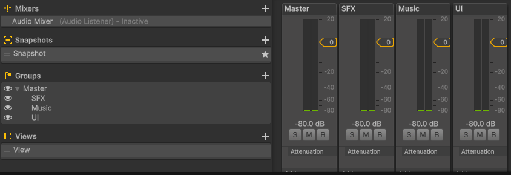

# ITU-CS-464-LAB-08-BSCS25067
 
**Student Name:** Abdullah Saeed  
**Roll Number:** BSCS25067  
**Course:** CS-464 Game Development (Lab 08 — Game Loading, Audio Architecture & C# Events)  
**Unity Version:** Unity 6 (6000.x)  
**Base Project:** Built directly on top of `ITU-CS-464-LAB-07-BSCS25067` (*Resident Evil 2 Remake* Mobile UI System)
 
---
 
## Demo Video
 
* **Full Flow, Audio Controls, Persistence & C# Events Demo:** [Google Drive Link](https://drive.google.com/file/d/1c_BYg42gqhYQxCRxz6NSbF39bb8bzxre/view?usp=sharing)
---
 
## Setup & How to Run
 
1. Clone this repository (`ITU-CS-464-LAB-08-BSCS25067`).
2. Open the project folder in **Unity Hub** using **Unity 6 (6000.x)**.
3. Verify that `MainMenu`, `Gameplay`, and `TransitionScene` are included in **File → Build Profiles / Build Settings**.
4. Open `Assets/Scenes/MainMenu.unity` and set the Game View to **16:9 Landscape (`1920x1080`)** or **Unity Device Simulator**.
5. Press **Play** to test the full loop:  
   **Launch → 10-Screen Lab 07 Menus → Audio Settings (with persistence) → Async Loading → Gameplay → Pause/Settings → Results → Replay / Main Menu**
---
 
## 1. Async Game Loading Flow
 
Scene transitions and asynchronous gameplay loading are handled by the persistent **`TransitionScene`** (`SceneTransition.cs`), which bootstraps additively at runtime:
 
- Selecting a difficulty (`Assisted`, `Normal`, or `Hardcore`) on Screen 10 invokes `SceneTransition.TransitionTo("Gameplay", showLoadingBar: true)`.
- The shutter overlay closes (`EaseOutCubic`), displays the `LoadingPanel` progress bar and percentage text, and starts `SceneManager.LoadSceneAsync("Gameplay", LoadSceneMode.Additive)` with `allowSceneActivation = false`.
- Real loading progress is normalized (`Mathf.Clamp01(loadOp.progress / 0.9f)`), preventing the player from entering gameplay until `loadOp.progress >= 0.9f` and the loading bar reaches `100%`.
- Once loaded, the previous scene is unloaded, the gameplay music crossfades in, and the shutters open (`EaseInCubic`).
---
 
## 2. Audio Mixer, Volume Mapping & Persistence
 
All audio is managed by a single persistent `DontDestroyOnLoad` **`AudioManager`** — no individual UI buttons hold an `AudioSource`.
 
### Mixer Groups
 
One Audio Mixer (`Audio Mixer`) routes all `AudioSource` components into four groups:
 
- **`Master`** (`MasterVol`) — Global output bus
- **`Music`** (`MusicVol`) — Dual `AudioSource` setup (`musicSourceA`, `musicSourceB`) for smooth looping track crossfades
- **`SFX`** (`SFXVol`) — Gameplay sound effects using `PlayOneShot` with slight random pitch variation
- **`UI`** (`UIVol`) — Reusable UI hover, click, back, panel open/close, pause, success, and error sounds

### Logarithmic Volume Mapping, Mute & Persistence
 
- Slider values (`0.0001f` to `1f`) are converted to decibels logarithmically rather than assigned linearly:
```csharp
float dB = linearValue <= 0.0001f ? -80f : Mathf.Log10(linearValue) * 20f;
mainMixer.SetFloat(exposedParam, dB);
```
 
- **Safe Mute:** Toggling Mute sets `MasterVol` directly to `-80 dB` without overwriting the user's saved slider position.
- **Persistence:** Every slider and mute change is saved via `PlayerPrefs` (`Vol_Master`, `Vol_Music`, `Vol_SFX`, `Vol_UI`, `Vol_Mute`) and restored automatically on startup in `AudioManager.Start()` and `AudioSettingsUI.OnEnable()`.
- **Pause Behavior:** Pausing sets `Time.timeScale = 0f` and `AudioListener.pause = true` so gameplay SFX pause cleanly, while `uiSource`, `musicSourceA`, and `musicSourceB` have `ignoreListenerPause = true` so menu feedback and background music continue seamlessly.
---
 
## 3. Music Transitions & Gameplay SFX
 
- **Music Crossfade:** `AudioManager.PlayMusic(AudioClip, float duration)` smoothly crossfades between two looping `AudioSource`s across states: **Main Menu → Gameplay → Results (Win/Loss)**.
- **Gameplay SFX:** Triggered via `AudioManager.Instance.PlaySFX(...)` using `PlayOneShot` with subtle pitch randomization (±0.05 to ±0.10) for Item Pickup, Player Damage, Heal, Death, and Scenario Cleared.
---
 
## 4. C# Events Architecture
 
Core gameplay state is decoupled from presentation using pure C# `event Action` delegates in `SurvivalGameEvents.cs` (`[DefaultExecutionOrder(-100)]`).
 
**Publisher:** `SurvivalGameEvents` — raises `OnDamaged`, `OnHealed`, `OnItemCollected`, `OnDied`, and `OnGameWon` safely using `?.Invoke(...)`.
 
**Independent Subscribers (3+ listeners):**
 
- **`GameplayHUDListener`** — Updates the health bar, RE2-style ECG status (`FINE` / `CAUTION` / `DANGER`), key item counter, and Results screen.
- **`GameplayAudioListener`** — Plays gameplay SFX (`PlayOneShot` + pitch variation) and triggers the results music crossfade.
- **`GameplayVFXListener`** — Triggers red/green screen hit-flashes and camera shake on damage/heal.
### Code Excerpt: Event Declaration, Safe Invocation & Subscribe/Unsubscribe Pair
 
**Publisher (`SurvivalGameEvents.cs`):**
 
```csharp
public event Action<int, int> OnDamaged;
public event Action OnDied;
 
public void TakeDamage(int amount)
{
    if (IsGameOver) return;
 
    CurrentHealth = Mathf.Max(0, CurrentHealth - amount);
    OnDamaged?.Invoke(CurrentHealth, maxHealth);
 
    if (CurrentHealth <= 0)
    {
        IsGameOver = true;
        OnDied?.Invoke();
    }
}
```
 
**Subscriber (`GameplayAudioListener.cs`):**
 
```csharp
private void OnEnable()
{
    if (SurvivalGameEvents.Instance == null) return;
    SurvivalGameEvents.Instance.OnDamaged += HandleDamaged;
    SurvivalGameEvents.Instance.OnDied += HandleDied;
}
 
private void OnDisable()
{
    if (SurvivalGameEvents.Instance == null) return;
    SurvivalGameEvents.Instance.OnDamaged -= HandleDamaged;
    SurvivalGameEvents.Instance.OnDied -= HandleDied;
}
```
 
---
 
## 5. Credits & Third-Party Asset Licences
 
- **UI Sound Effects:** *Interface Sounds* (100x audio files) by Kenney — Licence: Creative Commons CC0 ([kenney.nl](https://kenney.nl)).
- **Gameplay SFX & Background Music:** Capcom (For Main Theme) And [Youtube Link](https://www.youtube.com/watch?v=yXMhN9GmmPk&list=PLQMPh_k4bAcxvXQfH61W5Z3G4d9LWVAMs&index=2) (for ambience)
- **UI Visual Direction & Color Palette Inspiration:** *Resident Evil 2 Remake* (Capcom, 2019).
- **Menu Background Reference Image:** IGN
---